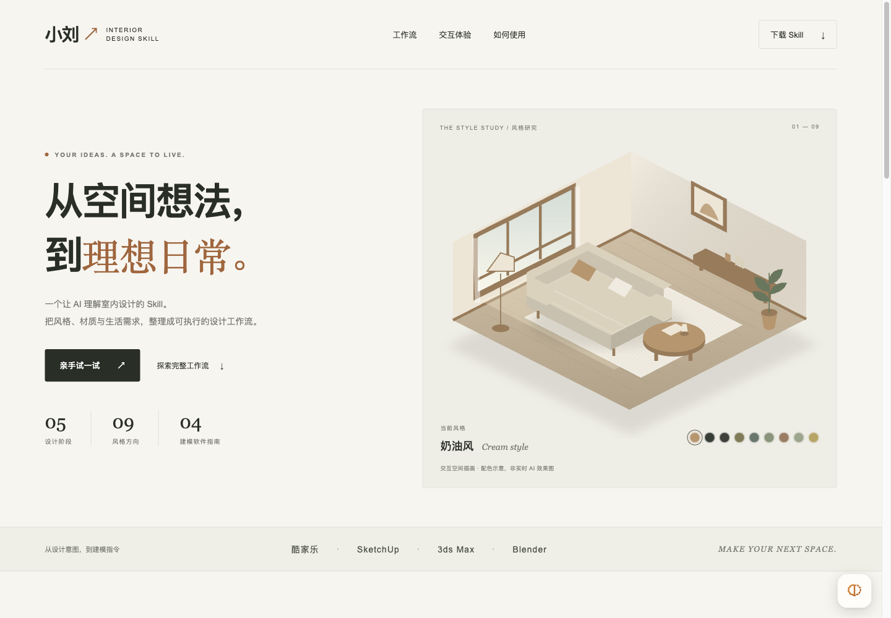

# 小刘 · Interior Design Skill

把室内设计需求整理为可执行的五阶段工作流：**需求分析 → 方案策划 → 效果图生成 → 改图迭代 → 建模落地**。

这是一个供支持 Skill 的 AI 助手使用的工作流与参考资料包，包含设计方案结构、9 种风格、图生图修改规范、4 款软件的建模指南及中英文生图提示词脚本。

## 能做什么

- 判断任务类型，按需求进入完整方案、效果图、改图、建模或风格建议分支。
- 整理空间、面积、风格、预算、居住成员与核心诉求，明确缺失信息和假设。
- 输出风格、布局、色彩、材质、灯光、家具、预算和待确认项组成的设计方案。
- 将方案参数组装为中文、英文模板及负面提示词，交给生图工具使用。
- 根据参考图编写风格转换、局部修改、配色和画质增强指令。
- 输出酷家乐、SketchUp、3ds Max、Blender 建模与渲染操作指南。

实际设计推理依赖 AI 助手，实际生成或修改图片依赖生图工具。此 Skill 不包含独立 AI 模型，也不直接控制建模软件。

## 安装

下载 [Skill 压缩包](docs/assets/interior-design-workflow.zip)，将解压后的 `interior-design-workflow` 文件夹放入所使用 AI 助手的 Skill 目录。不同客户端的安装方式以其说明为准。

文件结构：

```text
skill/interior-design-workflow/
├── SKILL.md
├── references/
│   ├── style-library.md
│   ├── prompt-library.md
│   ├── kujiale.md
│   └── 3d-modeling.md
└── scripts/
    └── build_prompt.py
```

## 使用示例

> 帮我设计一个 25㎡ 的奶油风客厅，增加收纳，保留采光，附上效果图提示词和酷家乐建模步骤。

> 将这张参考图改为日式原木风，保留空间结构与家具位置。

> 只输出 Blender 的建模和渲染操作步骤。

脚本可单独运行，仅使用 Python 标准库：

```bash
python3 skill/interior-design-workflow/scripts/build_prompt.py \
  --space "客厅" --area "25㎡" --style "奶油风" \
  --materials "微水泥、艺术漆、棉麻" \
  --lighting "3000K 暖光、氛围灯带" --mood "温暖松弛" \
  --view "三点透视" --extras "落地窗自然光，绿植点缀"
```

英文模板按原脚本映射风格和部分视角，其他输入原样保留。若需要纯英文，请用英文输入空间、材质、灯光、氛围与附加细节。

## 本地预览介绍页

在仓库目录运行：

```bash
python3 -m http.server 8765 --bind 127.0.0.1
```

然后打开 [本地交互介绍页](http://127.0.0.1:8765/docs/)。网站为 HTML/CSS/JavaScript 静态页面，无构建依赖。

## 交互介绍页

[**打开交互介绍页 →**](https://ethan101-liu.github.io/xiaoliu-Interior-design-skill/)



介绍页包含可切换配色的空间插画、五阶段流程、9 种风格、需求简报、与原脚本一致的提示词组装、改图指令和建模指南。

顶部风格色块、五阶段流程、交互区风格按钮、交付物标签与提示词语言按钮均支持鼠标悬停或点击切换。触屏使用点击操作，交付物标签也支持键盘方向键切换。

- [查看介绍页源页面](docs/index.html)
- [下载完整 Skill](docs/assets/interior-design-workflow.zip)
- [阅读原始 Skill](skill/interior-design-workflow/SKILL.md)

空间插画仅作配色示意；本地参考图只在浏览器中预览，不上传。页面生成设计输入与修改指令，不在浏览器中调用 AI 出图服务。

介绍页通过 GitHub Pages 发布，仓库右侧 About → Website 也提供同一访问入口。
